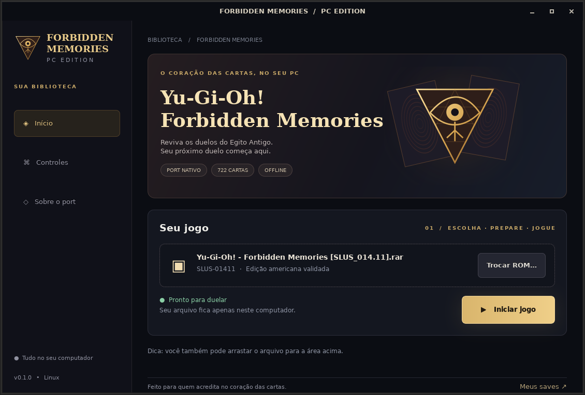

# ForbiddenMemoriesPC

Repositório de [GenissonEmilio](https://github.com/GenissonEmilio/ForbiddenMemoriesPC),
baseado no port nativo de [Unchiga e colaboradores](https://github.com/Unchiga/Yu-Gi-Oh-Forbidden-Memories-Recompiled)
(base `2d3776e86d075fbbed0605f3c068de86eb0d1651`). A autoria e as licenças originais são preservadas.

## Instalar e jogar no Linux

**A forma recomendada é o [release gráfico para Linux](https://github.com/GenissonEmilio/ForbiddenMemoriesPC/releases).**

1. Baixe `ForbiddenMemoriesPC-0.1.0-linux-x86_64.tar.gz` e extraia a pasta inteira.
2. Abra o executável **ForbiddenMemoriesPC** com dois cliques.
3. Clique em **Escolher arquivo…**, selecione sua ROM e aguarde a preparação.
4. Clique em **Iniciar jogo**. Nas próximas sessões, sua ROM já estará lembrada.

Em **Sobre o port → Adicionar ao menu de aplicativos**, crie um atalho no Linux.
O release inclui a interface, o jogo compilado e as bibliotecas necessárias; não exige
Python, compilador ou instalação de pacotes de 32 bits. Compatível com Linux x86-64,
glibc 2.35+ (Ubuntu 22.04+, Debian 12+, Fedora atual), sessão gráfica e OpenGL.
O pacote não contém ROM. O launcher funciona offline e mantém os saves na pasta do usuário.



### Compilar a partir do código-fonte

```sh
python3 install.py --rom "/caminho/para/seu/Forbidden Memories.rar"
./play.sh
```

Aceita o disco americano SLUS-01411 em BIN/IMG e arquivos RAR/ZIP aninhados,
incluindo RAR com CloneCD (`.ccd`, `.img`, `.sub`). A imagem RAW é validada e copiada
para `game/rpg-yfm.bin`; o executável precisa corresponder ao SHA-256 da edição suportada.
O importador não executa documentos ou programas encontrados no arquivo.
RAR exige `libarchive`; BIN/IMG e ZIP não exigem bibliotecas Python adicionais.
`python3 install.py --check` verifica as ferramentas. `--play` abre o jogo após a instalação;
`--skip-test` omite os testes locais de gameplay. A primeira compilação baixa dependências verificadas.

O instalador compila o jogo nativo e valida a entrada na história, o primeiro duelo em duas execuções,
um duelo completo e save/load determinístico. Os resultados ficam em `tmp/validation/`.
Disco, arquivos extraídos, saves e resultados locais não são enviados ao GitHub.

## Referência web do Tenkaichi 3

[`reference/tenkaichi3`](reference/tenkaichi3) preserva o código de
[stufno102/Tenkaichi3Decomp](https://github.com/stufno102/Tenkaichi3Decomp)
no commit `81507cde58685a6f5aab917c298d9a9f82fe09b0`, com as correções de geração de dados web,
cache de compilação e preparação Cloudflare em Linux. O workflow `Web-port regressions`
valida `main`, `web-port` e pull requests com dados sintéticos e WebAssembly real.
Essa referência é específica de PS2 e continua exigindo o disco do BT3; ela não executa a ROM de PS1.
O Forbidden Memories deste repositório é o port nativo para PC. Não há build de navegador do Yu-Gi-Oh! aqui.

Veja [proveniência e validação](notes/fork-validation.md). A documentação original segue abaixo.

O código do launcher está em [`tools/launcher`](tools/launcher), com sua própria licença MIT.
Para gerar o mesmo pacote Linux com Docker:

```sh
sh tools/launcher/release/build-linux.sh 0.1.0
```

O workflow **Linux desktop launcher** compila o pacote sem ROM e testa a interface em
um Linux limpo sem Python, GTK ou pacotes de 32 bits instalados. Os testes de gameplay
com a ROM do usuário são executados localmente; o disco não é enviado à CI.

---

# Yu-Gi-Oh! Forbidden Memories Recompiled (base original)

**Yu-Gi-Oh! Forbidden Memories** (PS1, USA) rebuilt from its decompiled source as a
native PC game for Windows and Linux, with a macOS ARM64 source build. Bring your own disc image; no game data is
included but the text of the European translations (below).

This is not a static recompilation: the game code was decompiled
by hand into C that matches the original byte for byte, then ported to PC.


## Features

- Up to 4x internal resolution, widescreen and HD text
- **3D Monsters**: face-up monsters stand on the field as their battle models
- Optional **Forbidden Memories HD** pack: redrawn cards, frames and portraits
- Mods: framework for new cards past the original 722, fusions, textures, music, gameplay tables
- **FM Editor**: make mods without writing JSON: cards, art, fusions, duelists, decks, packs, the title screen and more ([guide](tools/pc/fm_editor/README.md))
- Save slots, fusion helper, card drop rates, rebindable controls
- **Game > Language**: the European releases' own English, French, German, Italian and Spanish


## Play

Download the latest build from [Releases](https://github.com/Unchiga/Yu-Gi-Oh-Forbidden-Memories-Recompiled/releases),
extract it and run `memories-pc.exe` (Windows) or `./memories-pc` (Linux). On first
launch, pick your USA disc's `.bin`. The game can tell you when a newer release is out
(**Help > Check for updates at start** turns it off; see [Updates](notes/updates.md)).

### Bring your save from an emulator

Your save from the original game (an emulator's memory card, or a PS1 card copied to a PC)
loads in the port. Copy the memory card file (`.mcr`, `.mcd`, `.srm`, `.gme`, `.mcs`, `.psv`,
...; DuckStation keeps its cards in its `memcards` folder, ePSXe in `memcards`) into the
port's `saves` folder: `Documents\My Games\YFM Re-Decomp\saves` on Windows,
`~/.local/share/YFM Re-Decomp/saves` on Linux. Then pick **LOAD** on the title screen: the
save is copied into an empty slot (the card file is renamed `.imported`) and you can load it.
Emulator save states are not memory cards and cannot be imported; save in game first.

### HD pack

1. From the same release, download `yfm-redecomp-hd-mod-<version>.zip`.
2. Close the game and extract the zip into the game folder, the one with `memories-pc.exe`
   or `memories-pc`. You should end up with `mods/assets-hd` beside the other mods.
3. Start the game. The pack is on by default: press **F10** for the menu bar and open
   **Game > Mods** to check it, or to turn it or any of its parts off.
4. For the best look, pick **Video > Resolution > Internal 4x** and turn on **Video > HD text**.

**From source:** put the `.bin` in `game/` and run `play.bat` or `./play.sh`. The first
run builds everything (Linux needs `gcc` and `python3`). See [PC build](notes/pc-build.md).

On Apple Silicon, `./play.sh` builds and runs the macOS target using Python 3,
Xcode command-line tools, and verified dependencies installed under `tmp/`.
See [macOS build](notes/macos-build.md) and the [ARM64 runtime guide](notes/macos-arm64.md).
Native save states use F5/F7 and have build and platform compatibility limits;
see [save-state compatibility](notes/macos-arm64.md#save-state-use-and-compatibility). Code mods
need a macOS ARM64 build; existing i386 code-mod binaries cannot be loaded.
See [macOS code mods](notes/modding.md#native-macos-arm64-code-mods).

**Languages:** `languages/*.txt` is the text of the five European releases, read off the
PAL discs by the port itself. With the discs in `game/pal`, `python3 tools/pc/export_languages.py`
writes them again, and `--check` compares them ([Translations](notes/translation.md),
"The official languages"). They are the only game data in the repository: text, no pictures.

## Decompilation

Every game function matches the original executable byte for byte:

```sh
make tools   # pinned toolchain
make match   # rebuild SLUS_014.11 exactly (see notes/setup.md)
```

<details>
<summary>Progress</summary>

<!-- BEGIN GENERATED PROGRESS -->

| Metric | Current |
|---|---:|
| Game C-decompilation targets matched | **1,134 / 1,134 (100.00%)** |
| Game C-decompilation target bytes matched | **356,080 (`0x56EF0`) / 356,080 (`0x56EF0`) (100.00%)** |
| Remaining game C-decompilation targets | 0 functions, 0 (`0x0`) |
| Evidence-backed handwritten game assembly | 61 functions, 40,116 (`0x9CB4`) |
| Total game-owned functions | 1,195 |
| Preserved Psy-Q CRT/SDK assembly | 591 functions, 117,348 (`0x1CA64`) |
| Total discovered functions | 1,786 |
| Embedded/unassigned resident text | 1,780 (`0x6F4`) |

Runtime overlay modules:

| Module | Matching C functions | Matching C bytes |
|---|---:|---:|
| `free_duel` | 9 / 9 (100.00%) | 4,140 (`0x102C`) / 4,140 (`0x102C`) (100.00%) |
| `main_menu` | 31 / 31 (100.00%) | 17,724 (`0x453C`) / 17,724 (`0x453C`) (100.00%) |
| `overworld_after_coup` | 15 / 15 (100.00%) | 6,184 (`0x1828`) / 6,184 (`0x1828`) (100.00%) |
| `overworld_before_coup` | 15 / 15 (100.00%) | 6,184 (`0x1828`) / 6,184 (`0x1828`) (100.00%) |
| `password` | 27 / 27 (100.00%) | 10,884 (`0x2A84`) / 10,884 (`0x2A84`) (100.00%) |

_Generated from `config/slus_01411/functions.csv` and `config/slus_01411/overlays/*_functions.csv` by `tools/project/progress.py`._

<!-- END GENERATED PROGRESS -->

</details>

## Docs

[Modding](notes/modding.md) · [FM Editor](tools/pc/fm_editor/README.md) · [More cards](notes/more-cards.md) · [Fusion helper](notes/fusion-helper.md) ·
[Card drops](notes/card-drops.md) · [Card packs](notes/card-packs.md) · [Translations](notes/translation.md) · [Updates](notes/updates.md) · [Setup](notes/setup.md) · [Build](notes/build.md) ·
[Releases](notes/pc-release.md)

## Community

Join the [Discord](https://discord.gg/Gn6Mag52q) to follow development, ask questions
and report issues.

## License

The PC port (`src/pc/`, `tools/pc/`, `tests/pc/`, `mods/`, `examples/` and the build
and play scripts) is [MIT](LICENSE): keep the copyright notice and please link back
here. The decompilation builds on [memories-decomp](https://github.com/krystalgamer/memories-decomp)
by its authors. Yu-Gi-Oh! and Forbidden Memories belong to Konami.
